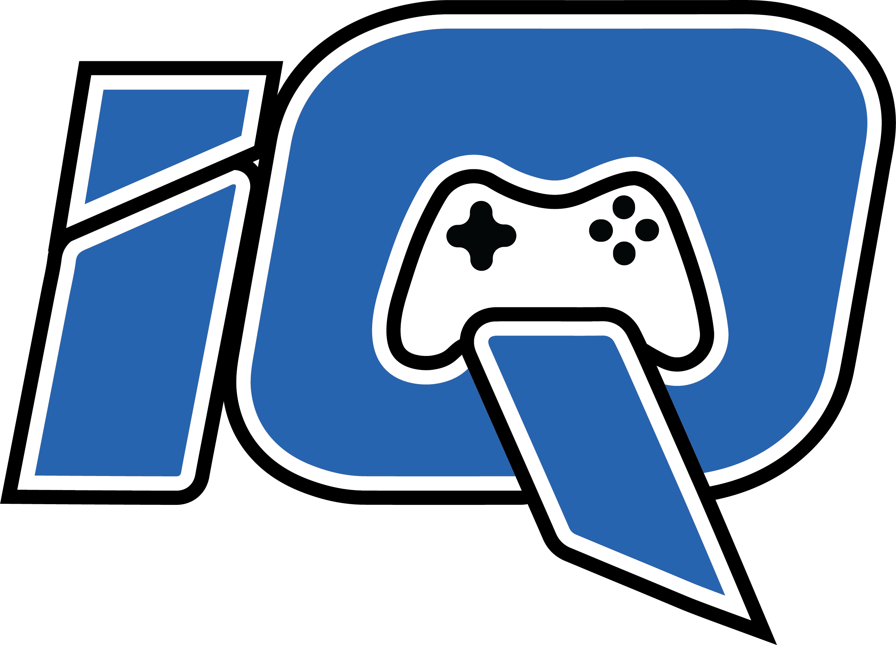

<h1 align="center">
  iQ GamerZ ELO

  A bot for matchmaking on Discord.
</h1>

  

<h1 align="center">
Commands
</h1>

## Index

- [Index](#índice)
- [How do I claim my V1 and V2 roles?](#how-do-I-claim-my-V1-and-V2-roles)

## How do I claim my V1 and V2 roles?
### With an active subscription:

With an active subscription, you can claim both versions for free, but it depends on your membership; *IQ Warrior Tier/IQ Warrior Subscribers* can only claim V1 for free.

Using the /claimbadge command, select the following:
- Claim: choose which role you want to claim from versions 1 and 2. You can also select both at the same time using *V1 & V2*.
- Payment_v1: if you have any of the three membership plans, you can claim the V1. Choosing between Subscription, ELO, and MVPs.
- Payment_v2: if you want to claim both roles at the same time, you can pay for both using the “subscription” method. This is only available to *IQ King Tier/Subscriber* and *IQ Queen Tier/Subscriber*.

_**Note**: If you are an *IQ Warrior Tier/Subscriber* member, you can also choose V2 and pay for it with ELO or MVPs._

  

### No active subscriptions:

Using the /claimbadge command, select the following:
- Claim: choose which role you want to claim from versions 1 and 2. You can also select both at the same time using *V1 & V2*.
- Payment_v1/v2: You'll need to choose between ELO and MVPs to claim your desired role, and then the amount assigned to your stats will be deducted.

_**Note**: You can pay for both roles with the same “currency,” or you can alternate between ELO and MVPs._

  

